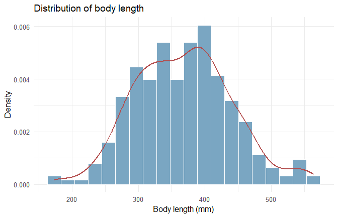
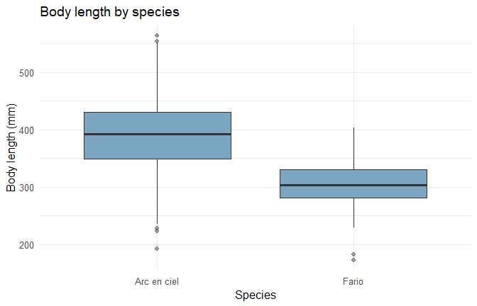
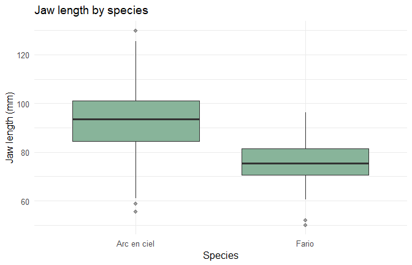
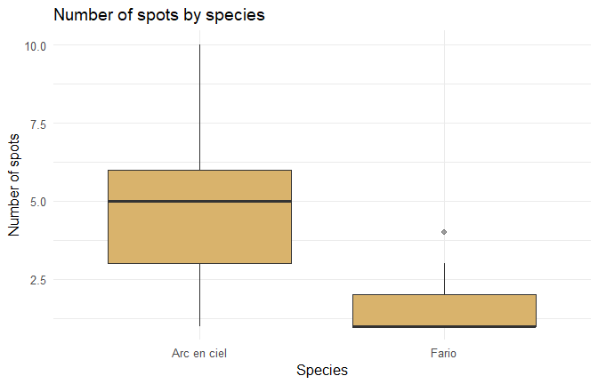
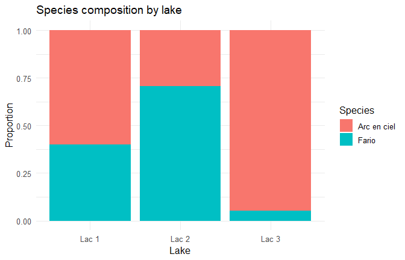
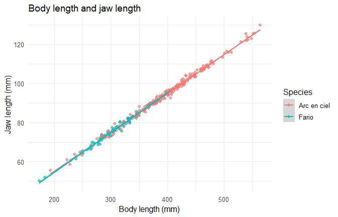

Exploratory and Inferential Analysis of Trout Morphology
================
Mahoulé Jude Bogninou and Laetitia Yangouen Nankam

- [1. Objective](#1-objective)
- [2. Data preparation](#2-data-preparation)
- [3. Descriptive analysis](#3-descriptive-analysis)
- [4. Inferential analysis](#4-inferential-analysis)
- [5. Relationship between body and jaw
  length](#5-relationship-between-body-and-jaw-length)
- [6. Conclusion and limitations](#6-conclusion-and-limitations)
- [7. Reproducibility](#7-reproducibility)

## 1. Objective

This project explores morphological measurements for two trout species
sampled in three lakes. It combines descriptive statistics, visual
exploration, and inferential methods. The aim is to describe the sample
and investigate associations, not to establish causality.

The questions are:

- How are body length, jaw length, and number of spots distributed?
- Do body and jaw lengths differ between species?
- Does the number of spots differ between species?
- Is species associated with lake of origin?
- How strongly are body length and jaw length related?

## 2. Data preparation

The source CSV uses semicolons as separators and commas as decimal
marks.

``` r
data_path <- file.path("data", "poissons.csv")
if (!file.exists(data_path)) {
  stop("File not found: data/poissons.csv. Knit from the repository root.")
}

trout <- read_delim(
  data_path,
  delim = ";",
  locale = locale(decimal_mark = ","),
  show_col_types = FALSE,
  trim_ws = TRUE
)

if (ncol(trout) != 6) stop("Expected six columns in the source dataset.")
names(trout) <- c(
  "id", "espece", "lac", "nb_taches",
  "longueur_corps", "longueur_machoire"
)

trout <- trout |>
  mutate(
    id = as.integer(id),
    espece = factor(espece),
    lac = factor(lac),
    nb_taches = as.integer(nb_taches),
    longueur_corps = as.numeric(longueur_corps),
    longueur_machoire = as.numeric(longueur_machoire)
  )

knitr::kable(
  data.frame(
    Variable = c("id", "espece", "lac", "nb_taches", "longueur_corps", "longueur_machoire"),
    Description = c(
      "Individual identifier", "Trout species", "Lake of origin",
      "Number of spots", "Body length (mm)", "Jaw length (mm)"
    ),
    Type = c("Identifier", "Categorical", "Categorical", "Discrete quantitative", "Continuous quantitative", "Continuous quantitative")
  ),
  caption = "Variables used in the analysis"
)
```

| Variable          | Description           | Type                    |
|:------------------|:----------------------|:------------------------|
| id                | Individual identifier | Identifier              |
| espece            | Trout species         | Categorical             |
| lac               | Lake of origin        | Categorical             |
| nb_taches         | Number of spots       | Discrete quantitative   |
| longueur_corps    | Body length (mm)      | Continuous quantitative |
| longueur_machoire | Jaw length (mm)       | Continuous quantitative |

Variables used in the analysis

### Data-quality checks

``` r
quality <- data.frame(
  Metric = c("Number of observations", "Number of variables", "Duplicate IDs", "Missing cells"),
  Value = c(nrow(trout), ncol(trout), sum(duplicated(trout$id)), sum(is.na(trout)))
)
knitr::kable(quality, caption = "Basic data-quality checks")
```

| Metric                 | Value |
|:-----------------------|------:|
| Number of observations |   306 |
| Number of variables    |     6 |
| Duplicate IDs          |     0 |
| Missing cells          |     0 |

Basic data-quality checks

There are 306 observations. Missing values and duplicate identifiers
should be reviewed before drawing conclusions. The analysis below uses
the supplied data as provided.

## 3. Descriptive analysis

### Species counts

``` r
species_counts <- trout |> count(espece, name = "n")
knitr::kable(species_counts, caption = "Number of observations by species")
```

| espece      |   n |
|:------------|----:|
| Arc en ciel | 224 |
| Fario       |  82 |

Number of observations by species

### Summary by species

``` r
species_summary <- trout |>
  group_by(espece) |>
  summarise(
    n = n(),
    body_mean_mm = mean(longueur_corps, na.rm = TRUE),
    body_sd_mm = sd(longueur_corps, na.rm = TRUE),
    jaw_mean_mm = mean(longueur_machoire, na.rm = TRUE),
    jaw_sd_mm = sd(longueur_machoire, na.rm = TRUE),
    spots_median = median(nb_taches, na.rm = TRUE),
    spots_IQR = IQR(nb_taches, na.rm = TRUE),
    .groups = "drop"
  )
knitr::kable(species_summary, digits = 2, caption = "Morphological measurements by species")
```

| espece | n | body_mean_mm | body_sd_mm | jaw_mean_mm | jaw_sd_mm | spots_median | spots_IQR |
|:---|---:|---:|---:|---:|---:|---:|---:|
| Arc en ciel | 224 | 391.65 | 65.64 | 93.28 | 13.10 | 5 | 3 |
| Fario | 82 | 302.60 | 40.58 | 75.47 | 8.29 | 1 | 1 |

Morphological measurements by species

### Distribution of body length

``` r
ggplot(trout, aes(x = longueur_corps)) +
  geom_histogram(aes(y = after_stat(density)), bins = 20,
                 fill = "#7AA6C2", colour = "white") +
  geom_density(colour = "#B34D4D", linewidth = 0.8) +
  labs(title = "Distribution of body length", x = "Body length (mm)", y = "Density") +
  theme_minimal(base_size = 12)
```



### Body and jaw length by species

``` r
ggplot(trout, aes(x = espece, y = longueur_corps)) +
  geom_boxplot(fill = "#7AA6C2", outlier.alpha = 0.45) +
  labs(title = "Body length by species", x = "Species", y = "Body length (mm)") +
  theme_minimal(base_size = 12)
```



``` r
ggplot(trout, aes(x = espece, y = longueur_machoire)) +
  geom_boxplot(fill = "#88B49A", outlier.alpha = 0.45) +
  labs(title = "Jaw length by species", x = "Species", y = "Jaw length (mm)") +
  theme_minimal(base_size = 12)
```



### Number of spots by species

``` r
ggplot(trout, aes(x = espece, y = nb_taches)) +
  geom_boxplot(fill = "#D9B36C", outlier.alpha = 0.45) +
  labs(title = "Number of spots by species", x = "Species", y = "Number of spots") +
  theme_minimal(base_size = 12)
```



### Species composition by lake

``` r
ggplot(trout, aes(x = lac, fill = espece)) +
  geom_bar(position = "fill") +
  labs(title = "Species composition by lake", x = "Lake", y = "Proportion", fill = "Species") +
  theme_minimal(base_size = 12)
```



## 4. Inferential analysis

The tests below compare groups or assess association. The choice of test
does not replace checking the design and assumptions. P-values should be
read alongside the observed differences and their uncertainty.

### Body length: Welch two-sample t-test

``` r
body_test <- t.test(longueur_corps ~ espece, data = trout)
body_test
```

    ## 
    ##  Welch Two Sample t-test
    ## 
    ## data:  longueur_corps by espece
    ## t = 14.201, df = 232.88, p-value < 2.2e-16
    ## alternative hypothesis: true difference in means between group Arc en ciel and group Fario is not equal to 0
    ## 95 percent confidence interval:
    ##   76.69483 101.40321
    ## sample estimates:
    ## mean in group Arc en ciel       mean in group Fario 
    ##                  391.6527                  302.6037

Welch’s test compares the group means without assuming equal population
variances. The reported confidence interval and p-value should be
interpreted with the group summaries above.

### Jaw length: Welch two-sample t-test

``` r
jaw_test <- t.test(longueur_machoire ~ espece, data = trout)
jaw_test
```

    ## 
    ##  Welch Two Sample t-test
    ## 
    ## data:  longueur_machoire by espece
    ## t = 14.06, df = 227.73, p-value < 2.2e-16
    ## alternative hypothesis: true difference in means between group Arc en ciel and group Fario is not equal to 0
    ## 95 percent confidence interval:
    ##  15.31089 20.30187
    ## sample estimates:
    ## mean in group Arc en ciel       mean in group Fario 
    ##                  93.27955                  75.47317

### Number of spots: Wilcoxon rank-sum test

``` r
spots_test <- wilcox.test(nb_taches ~ espece, data = trout, exact = FALSE)
spots_test
```

    ## 
    ##  Wilcoxon rank sum test with continuity correction
    ## 
    ## data:  nb_taches by espece
    ## W = 17385, p-value < 2.2e-16
    ## alternative hypothesis: true location shift is not equal to 0

The Wilcoxon test compares the distributions/ranks of the two groups; it
should not automatically be described as a test of medians unless
additional distributional assumptions are justified.

### Species and lake: Fisher’s exact test

``` r
species_lake_table <- table(trout$espece, trout$lac)
knitr::kable(as.data.frame.matrix(species_lake_table), caption = "Contingency table: species by lake")
```

|             | Lac 1 | Lac 2 | Lac 3 |
|:------------|------:|------:|------:|
| Arc en ciel |    94 |     5 |   125 |
| Fario       |    63 |    12 |     7 |

Contingency table: species by lake

``` r
fisher.test(species_lake_table)
```

    ## 
    ##  Fisher's Exact Test for Count Data
    ## 
    ## data:  species_lake_table
    ## p-value = 7.612e-16
    ## alternative hypothesis: two.sided

Fisher’s exact test assesses whether species and lake are statistically
associated in this sample. An association does not establish that the
lake causes a difference in species composition.

## 5. Relationship between body and jaw length

``` r
ggplot(trout, aes(x = longueur_corps, y = longueur_machoire, colour = espece)) +
  geom_point(alpha = 0.65) +
  geom_smooth(method = "lm", formula = y ~ x, se = TRUE, linewidth = 0.8) +
  labs(title = "Body length and jaw length", x = "Body length (mm)",
       y = "Jaw length (mm)", colour = "Species") +
  theme_minimal(base_size = 12)
```



### Pearson correlation in the pooled sample

``` r
cor_test <- cor.test(trout$longueur_corps, trout$longueur_machoire, method = "pearson")
cor_test
```

    ## 
    ##  Pearson's product-moment correlation
    ## 
    ## data:  trout$longueur_corps and trout$longueur_machoire
    ## t = 235.07, df = 304, p-value < 2.2e-16
    ## alternative hypothesis: true correlation is not equal to 0
    ## 95 percent confidence interval:
    ##  0.9965698 0.9978123
    ## sample estimates:
    ##       cor 
    ## 0.9972605

### Correlation within each species

``` r
within_species_correlations <- trout |>
  group_by(espece) |>
  summarise(
    n = sum(complete.cases(longueur_corps, longueur_machoire)),
    pearson_r = cor(longueur_corps, longueur_machoire,
                    use = "complete.obs", method = "pearson"),
    .groups = "drop"
  )
knitr::kable(within_species_correlations, digits = 3,
             caption = "Pearson correlation within each species")
```

| espece      |   n | pearson_r |
|:------------|----:|----------:|
| Arc en ciel | 224 |     0.997 |
| Fario       |  82 |     0.992 |

Pearson correlation within each species

A pooled correlation may partly reflect differences between species.
Comparing the within-species correlations helps distinguish the overall
pattern from the relationships observed within each group. Correlation
alone does not establish causality.

## 6. Conclusion and limitations

This analysis illustrates a reproducible workflow for descriptive
statistics, visualization, group comparisons, categorical association,
and correlation. Any substantive conclusion should be based on the
actual test outputs, effect sizes, uncertainty, and sampling design
rather than p-values alone.

Limitations to keep in mind:

- The analysis is exploratory and based on one supplied dataset.
- Species and lake may be associated, which can affect pooled
  comparisons.
- Several tests are performed; a formal study should consider
  multiplicity and report effect sizes and confidence intervals where
  appropriate.
- The number of spots is treated as a measured variable from the
  assignment. Interpreting it as an indicator of stress would require
  independent biological validation.
- The analysis does not establish causal relationships.

## 7. Reproducibility

The report is generated from `analysis.Rmd` and `data/poissons.csv`. To
reproduce it, run `rmarkdown::render("analysis.Rmd")` from the
repository root in an R environment with the required packages
installed.
